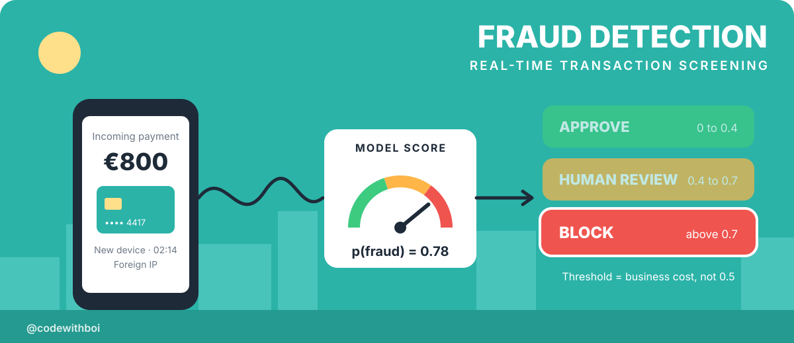
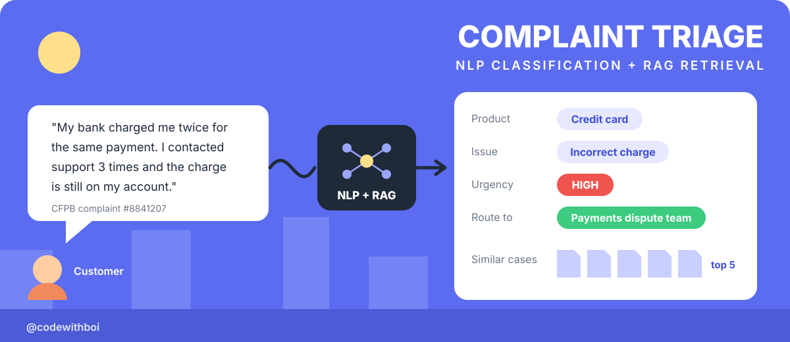
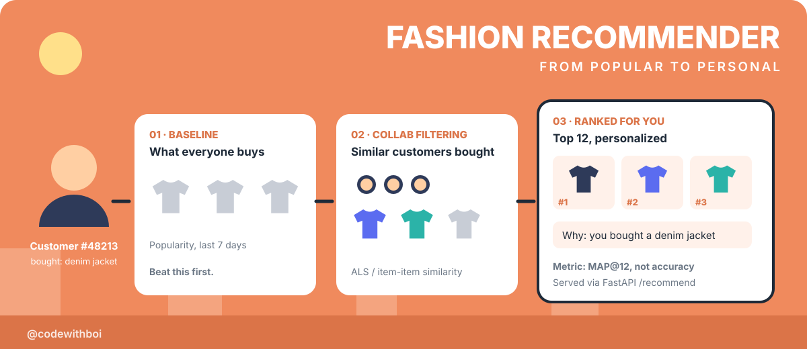
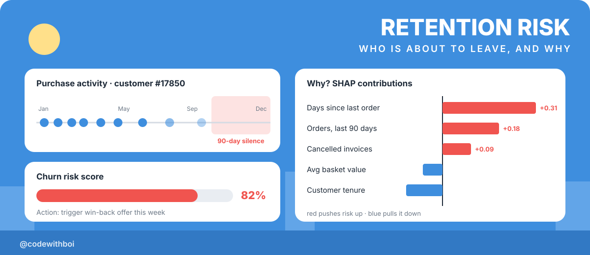
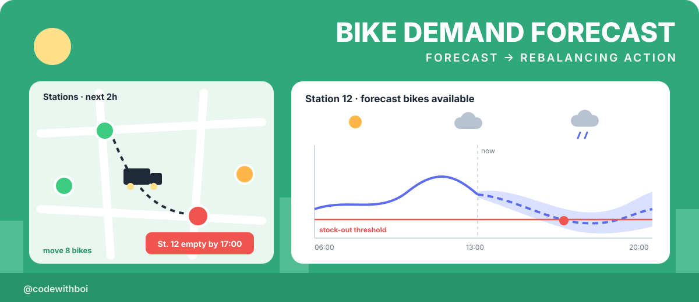

# 5 Data Projects That Actually Get You Hired

> Titanic and Iris are not portfolio projects. Thousands of people have built them.
> These five use real, messy data and end in a business decision, which is what hiring managers look for.

**Pick ONE. Build it end to end. Ship it.** The goal is role fit, not five half-finished notebooks.

⭐ Star this repo so you can find it again.

---

## TL;DR

| # | Project | Level | Best for | Core skill |
|---|---------|-------|----------|------------|
| 1 | [Fraud Detection](#1-fraud-detection) | Advanced | DS, MLE, Risk | Imbalanced classification, cost-based thresholds |
| 2 | [Complaint Triage + Retrieval](#2-complaint-triage--retrieval) | Int. to Adv. | Applied AI, NLP | Text classification, RAG |
| 3 | [Fashion Recommender](#3-fashion-recommender) | Advanced | MLE, RecSys | Candidate generation + ranking |
| 4 | [Retention Risk](#4-retention-risk) | Intermediate | DS, Product Analytics | Feature engineering, SHAP |
| 5 | [Bike Demand Forecasting](#5-bike-demand-forecasting) | Int. to Adv. | DA, DS, Analytics Eng. | Multi-source joins, time series |

## The 5 rules every project must pass

1. **A real business decision.** What action does your output trigger?
2. **Real, messy data.** Missing values, broken joins, changing schemas.
3. **Baseline first.** Start simple, then add complexity only where the baseline fails.
4. **Deployed.** An API, an app or a scheduled pipeline. A notebook on your laptop does not count.
5. **Results AND limitations.** Say where your model breaks. Most people skip this.

---

## 1. Fraud Detection



**What it is:** Score every incoming transaction and decide whether to approve it, send it to a human or block it.

** The focus:** A probability is not a decision. Set thresholds from the **cost of each error**: a blocked real customer, a missed fraud, analyst time spent on review. Show the precision/recall trade-off in money, not just in AUC.

**Build plan**
1. Split the data by time, never randomly, so there is no leakage from the future.
2. Baseline: logistic regression. Then try LightGBM or XGBoost.
3. Handle class imbalance (about 3.5% fraud) with class weights or resampling, and evaluate with PR-AUC.
4. Calibrate the probabilities and pick thresholds for approve, review and block.
5. Serve it as a `/score` API.

**Stack:** `Python` `pandas` `scikit-learn` `LightGBM` `imbalanced-learn` `FastAPI` `Docker`

**Data:** [IEEE-CIS Fraud Detection (Kaggle)](https://www.kaggle.com/c/ieee-fraud-detection). About 590K transactions and 400+ features. A free Kaggle account is enough.

**Why it matters:** Fraud is one of the biggest production ML use cases. Every bank, fintech and marketplace loses money both to missed fraud and to false blocks.

---

## 2. Complaint Triage + Retrieval



**What it is:** A complaint comes in. Classify it, score its urgency, route it to the right team and retrieve similar past cases.

**The focus:** You are building a triage system, not a chatbot. Every output field is a decision someone acts on. Write down where a human must stay in the loop. That responsible-use section is what makes it look production-grade.

**Build plan**
1. Ingest from the API, then clean and deduplicate the narratives.
2. Baseline: TF-IDF + logistic regression for product and issue. Then try a fine-tuned transformer.
3. Add urgency scoring and team-routing rules.
4. Embed past complaints and retrieve the top-k similar cases from a vector store.
5. Deploy a simple triage UI.

**Stack:** `Python` `scikit-learn` `Hugging Face Transformers` `sentence-transformers` `FAISS` / `Chroma` `FastAPI` `Streamlit`

**Data:** [CFPB Consumer Complaint Database API](https://cfpb.github.io/api/ccdb/). Official US government data, updated daily, with personal details removed.

**Why it matters:** Support and compliance teams handle thousands of tickets a day. Faster routing means lower cost and less regulatory risk. It is also exactly the NLP + RAG skill set that applied AI roles hire for.

---

## 3. Fashion Recommender



**What it is:** Predict the next 12 items each customer will buy.

** The focus:** This is a two-stage system: candidate generation, then ranking. Beat the popularity baseline first. Evaluate with **MAP@12, Recall@K and NDCG**, not accuracy, and explain why. Return recommendations **with a reason**.

** Build plan**
1. Baseline: the most popular items from the last week.
2. Candidate generation with collaborative filtering (ALS or item-item).
3. Rank the candidates with a learning-to-rank model (LightGBM ranker).
4. Validate on a time split: train on weeks 1 to N, test on week N+1.
5. Serve the top-N results from a `/recommend` API.

**Stack:** `Python` `Polars` `implicit` `LightGBM` `FastAPI`

**Data:** [H&M Personalized Fashion Recommendations (Kaggle)](https://www.kaggle.com/competitions/h-and-m-personalized-fashion-recommendations). 31M+ transactions, 1M+ customers, 100K+ products, with images and metadata.

**Why it matters:** Recommendations drive a large share of e-commerce and streaming revenue. The size of this dataset forces you to solve real engineering problems.

---

## 4. Retention Risk



**What it is:** Flag the customers who are about to stop buying, and explain why for each one.

**The focus:** There is no churn label, so **you define it**. Choose the inactivity window and defend that choice. A risk score only becomes useful when marketing can act on it, so explain every score with SHAP.

**Build plan**
1. Define the inactivity window and build the label.
2. Engineer RFM (recency, frequency, monetary) and behavioral features. Handle cancellations and missing customer IDs.
3. Baseline: logistic regression. Then try XGBoost.
4. Explain each customer's score with SHAP.
5. Deploy a scoring app that re-scores on a schedule.

**Stack:** `Python` `pandas` `scikit-learn` `XGBoost` `SHAP` `Streamlit` `Prefect`

**Data:** [Online Retail II (UCI)](https://archive.ics.uci.edu/dataset/502/online+retail+ii). About 1M real transactions. Free and no account needed.

**Why it matters:** Keeping a customer costs far less than acquiring a new one. Every subscription and retail business wants this model.

---

## 5. Bike Demand Forecasting



**What it is:** Forecast demand at each station using trip history, weather and calendar features.

**The focus:** The forecast is not the job. **The rebalancing decision is.** Forecast per station, not a citywide average, and flag stations that will run out of bikes or free docks.

**Build plan**
1. Ingest trips and weather, then fix the schemas (station names and columns change over time).
2. Join on station and hour, and add calendar features (holidays, weekday, hour).
3. Baseline: seasonal naive. Then try LightGBM or Prophet for each station.
4. Backtest with a time-based split.
5. Deploy a dashboard with stock-out alerts and suggested bike moves.

**Stack:** `Python` `pandas` `LightGBM` / `Prophet` `Open-Meteo API` `Plotly Dash` / `Streamlit`

**Data:**
- [Citi Bike System Data](https://citibikenyc.com/system-data). Trip files, updated monthly.
- [Open-Meteo](https://open-meteo.com/). Free weather API, up to 10K calls a day.

**Why it matters:** It proves you can merge messy sources and turn a forecast into an operational decision. That carries over directly to logistics, mobility and supply chain work.

---

## ✅ Ship checklist (before you post it)

- [ ] README with the problem, the decision, your results and **your limitations**
- [ ] A baseline vs. final model comparison table
- [ ] A time-based split wherever time exists
- [ ] A live demo link (Streamlit Cloud, Hugging Face Spaces or Render)
- [ ] `requirements.txt` or `pyproject.toml` with pinned versions
- [ ] A 60-second screen recording of the demo for LinkedIn

```
project/
├── data/          # raw (git-ignored) + processed
├── notebooks/     # EDA only
├── src/           # features, train, evaluate, serve
├── app/           # API or UI
├── tests/
└── README.md
```

---

Breakdown, build plans and illustrations by [@codewithboi](https://instagram.com/codewithboi).

Building one of these? Tag **@codewithboi**. I want to see it.
